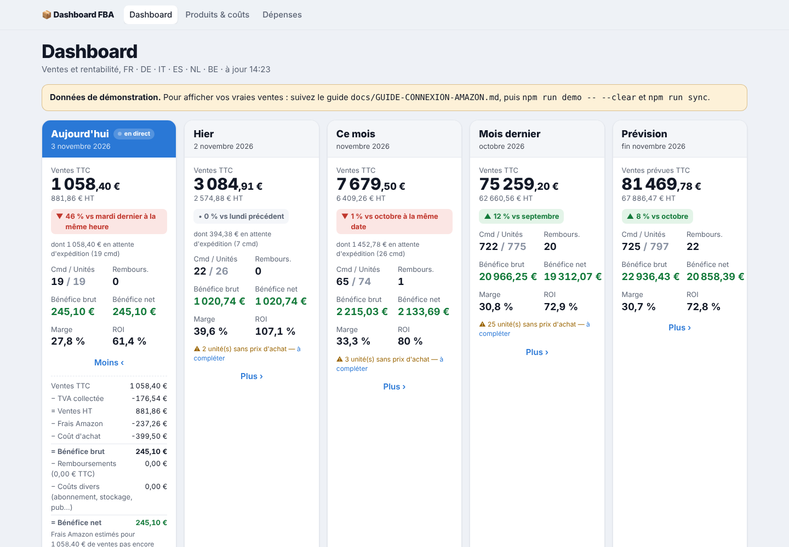
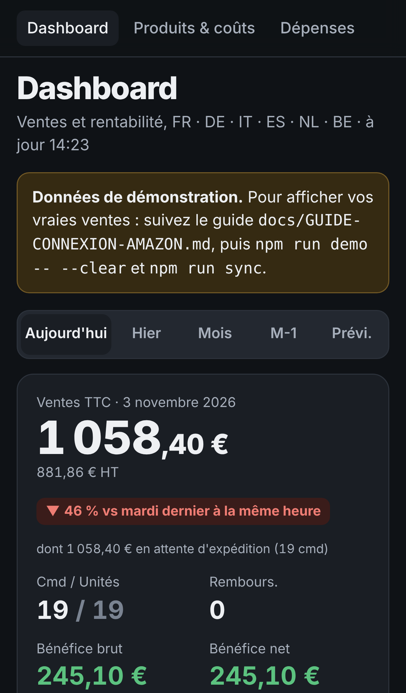

# Dashboard FBA

Tableau de bord des ventes et de la rentabilité Amazon FBA, branché directement sur l'API Amazon (SP-API).
Toutes marketplaces européennes, en temps quasi réel, utilisable sur ordinateur et sur téléphone (thème clair et sombre).





## Ce que vous voyez

**5 cartes** : Aujourd'hui (en direct) · Hier · Ce mois · Mois dernier · Prévision de fin de mois. Chaque carte affiche :

- **Ventes TTC** (en grand) et **HT**
- **Comparaison** : aujourd'hui vs le même jour la semaine dernière *à la même heure*, hier vs le même jour la semaine précédente, ce mois vs le mois dernier à la même date…
- **Commandes / unités**, **remboursements**
- **Bénéfice brut**, **bénéfice net**, **marge**, **ROI**
- **« dont X € en attente d'expédition »** pour les commandes pas encore expédiées
- **Plus ›** : le détail du calcul, de la TVA jusqu'au bénéfice net

Plus :

- un **graphique** du CA (ou du bénéfice) par jour du mois ou par mois de l'année, avec navigation ‹ ›
- la **rentabilité par produit** sur la période de votre choix
- une page **Produits & coûts** pour saisir vos prix d'achat (ou import CSV)
- une page **Dépenses** pour vos coûts hors Amazon (publicité, logiciels, prep center…)
- une page **Amazon** : test de la connexion, état de la synchro, ré-import de l'historique, sans ligne de commande

Sur mobile, les cartes deviennent des onglets **Aujourd'hui · Hier · Mois · M-1 · Prévi.**

## Démarrage rapide (avec des données de démonstration)

Prérequis : [Node.js](https://nodejs.org) 20 ou plus.

```bash
npm install
npm run demo        # remplit la base avec ~14 mois de ventes fictives
npm run dev         # puis ouvrez http://localhost:3000
```

## Brancher votre compte Amazon

👉 **Suivez le guide pas à pas : [docs/GUIDE-CONNEXION-AMAZON.md](docs/GUIDE-CONNEXION-AMAZON.md)**

En résumé :

1. Seller Central → Applications et services → Développer des applications → profil **développeur privé**
2. Rôles : *Finance et comptabilité*, *Suivi des stocks et des commandes*, *Tarification*
3. Créez l'application, copiez **Client ID** + **Client Secret**, cliquez sur **Autoriser** pour obtenir le **refresh token**
4. `cp .env.example .env` et collez les 3 identifiants
5. Déployez (Portainer, Docker ou `npm run build && npm start`)
6. Page **Amazon** du dashboard → **Tester la connexion** → tout doit être ✅ (ou `npm run check-amazon`)

## Comment les chiffres sont calculés

| Indicateur | Calcul |
|---|---|
| **CA TTC** | Prix payé par le client : article + frais de port + emballage cadeau − promotions |
| **TVA** | TVA incluse dans le CA, au taux du pays de la marketplace (FR 20 %, DE 19 %, IT 22 %, ES 21 %…) ou montant de taxe fourni par Amazon |
| **CA HT** | CA TTC − TVA |
| **Frais Amazon** | Commission + frais d'expédition FBA + autres frais par commande. **Réels** (API Finances) dès qu'Amazon a réglé la commande, sinon **estimés** |
| **Coût d'achat** | Unités × (prix d'achat + coût annexe par unité) |
| **Bénéfice brut** | CA HT − frais Amazon − coût d'achat |
| **Remboursements** | Montant remboursé HT − frais rendus par Amazon + frais de remboursement − coût d'achat récupéré si l'article revient en stock (`RETURN_RESTOCK_RATE`) — comptés à la date du remboursement |
| **Coûts divers** | Frais Amazon hors commande (abonnement, stockage, frais d'envoi en entrepôt…) + vos dépenses saisies |
| **Bénéfice net** | Bénéfice brut − remboursements − coûts divers |
| **Marge** | Bénéfice net ÷ CA HT |
| **ROI** | Bénéfice net ÷ coût d'achat |
| **Prévision** | Réalisé du mois + moyenne des 14 derniers jours × jours restants |

Les ventes sont rattachées à la **date de commande** (fuseau `Europe/Paris`), les remboursements et frais divers à leur **date de comptabilisation**.

Si vous n'êtes pas assujetti à la TVA (`VAT_REGISTERED=false`), la TVA n'est pas déduite : le bénéfice et la marge sont calculés sur le CA TTC, et la TVA payée sur les frais Amazon est ajoutée aux frais.

**Estimation des frais** des commandes pas encore réglées, dans l'ordre :
1. frais réels moyens par unité du même produit sur les 120 derniers jours, ajustés de la commission (~15 %) si le prix a changé ;
2. estimation de l'API Amazon Product Fees ;
3. à défaut, `FALLBACK_FEE_RATE` % du prix TTC (35 % par défaut).

## Commandes utiles

| Commande | Rôle |
|---|---|
| `npm run dev` | Lance le dashboard en mode développement |
| `npm run build && npm start` | Lance le dashboard en production (synchro automatique) |
| `npm run check-amazon` | Vérifie la connexion à l'API Amazon étape par étape |
| `npm run sync` | Synchronise maintenant (`-- --days 180` pour ré-importer 180 jours) |
| `npm run import-cogs -- fichier.csv` | Importe les prix d'achat (`sku;prix_achat;cout_annexe`) |
| `npm run demo` / `npm run demo -- --clear` | Charge / efface les données de démonstration |
| `npm test` | Tests des calculs et du décodage des réponses Amazon |

## Hébergement

- **Portainer** (recommandé) : une image prête à l'emploi est publiée automatiquement sur `ghcr.io/ynk22/dashboard-fba` (amd64 + arm64).
  Collez [`docker-compose.portainer.yml`](docker-compose.portainer.yml) dans une stack et renseignez les variables.
  👉 **Guide : [docs/DEPLOIEMENT-PORTAINER.md](docs/DEPLOIEMENT-PORTAINER.md)**
- **Docker Compose** : `docker compose up -d --build` (construit l'image sur place, la base est conservée dans un volume).
- **Local** : `npm run build && npm start`, accessible sur votre réseau via `http://IP:3000`.

Définissez **`DASHBOARD_PASSWORD`** dès que le dashboard est accessible depuis Internet, et placez-le derrière HTTPS.
Le dashboard a besoin d'un disque persistant (base SQLite) et d'un processus qui tourne en continu pour la synchronisation : les hébergeurs « serverless » (Vercel, Netlify) ne conviennent pas tels quels.

## Architecture

```
src/
  lib/
    spapi/client.ts     Authentification LWA, quotas (token bucket), réessais sur 429/5xx
    spapi/orders.ts     Orders API v2026-01-01 (searchOrders) → commandes + articles
    spapi/finances.ts   Finances API v2024-06-19 (listTransactions) → frais, remboursements
    spapi/fees.ts       Product Fees API v0 (getMyFeesEstimates) → estimation des frais
    sync.ts             Synchronisation incrémentale vers SQLite
    metrics.ts          Calculs (CA, bénéfice, marge, ROI, prévision) — fonctions pures testées
    queries.ts          Lecture de la base, cartes du dashboard, graphiques, tableau produits
    db.ts               Schéma SQLite
  app/                  Pages Next.js (dashboard, produits, dépenses) et routes /api/*
  components/           Cartes, graphique, formatage
  instrumentation.ts    Synchronisation automatique en arrière-plan
  proxy.ts              Protection par mot de passe (sauf /api/health, pour le healthcheck Docker)
scripts/                sync, check-amazon, import-cogs, demo
Dockerfile, docker-compose*.yml, .github/workflows/docker.yml   Image Docker publiée sur ghcr.io
tests/                  Tests unitaires (node:test)
```

Stack : Next.js 16, React 19, TypeScript, SQLite (better-sqlite3). Aucune donnée n'est envoyée ailleurs qu'entre votre serveur et Amazon.

## Limites connues

- Le prix d'achat est unique par SKU : le modifier recalcule aussi l'historique.
- La TVA est calculée au taux du pays de la marketplace. Les ventes B2B en autoliquidation et les expéditions vers un autre pays que celui de la marketplace (Pan-EU, OSS) peuvent légèrement différer de votre déclaration de TVA.
- Les devises hors euro (SEK, PLN, GBP) sont converties avec des taux fixes (`FX_RATES`), à ajuster de temps en temps.
- Les dépenses publicitaires ne sont pas récupérées automatiquement (l'API Amazon Ads est séparée) : saisissez-les dans **Dépenses**.
